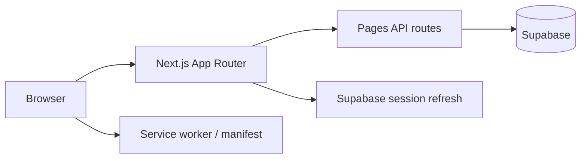

# Recipe Book Platform


Full-stack recipe collection app: browse and search recipes, save favorites, and manage your personal cookbook. Built with Next.js, Supabase, and a PWA-ready frontend (Swedish UI).

**Live demo:** [recipe-book-platform.netlify.app](https://recipe-book-platform.netlify.app)

## Status

- **CI:** lint, unit tests, build, E2E smoke, optional Supabase verify, auto-deploy to Netlify on `main`
- **Deploy:** [recipe-book-platform.netlify.app](https://recipe-book-platform.netlify.app) via Netlify (post-deploy health check on `/recept`)
- **SEO:** Open Graph metadata per recipe, `sitemap.xml`, `robots.txt`, App Router `not-found`

## Highlights

- **Recipe library** with search, meal/diet filters, and detail pages
- **DB metadata** — `meal_type`, `tags`, `prep_time_minutes` on recipes (with client-side inference fallback)
- **Authentication** via Supabase (register, login, email callback, password reset)
- **Favorites** synced for logged-in users (`/api/favorites/recipes` lightweight endpoint)
- **App Router** for all UI pages; Pages Router kept for API routes
- **PWA support** — manifest, versioned service worker (network-first HTML), mobile-friendly layout
- **Observability** — optional Sentry when `NEXT_PUBLIC_SENTRY_DSN` is set

## Screenshots

| Home | Recipe library | Recipe detail |
|------|----------------|---------------|
|  |  |  |

| Login | Saved recipes |
|-------|----------------|
|  |  |

## Tech stack

| Layer | Choice |
|-------|--------|
| Frontend | Next.js 16, React 19, TypeScript, Tailwind CSS |
| Backend | Next.js Pages API routes |
| Database / Auth | Supabase (PostgreSQL + Auth) |
| Deploy | Netlify (`@netlify/plugin-nextjs`) |
| Legacy | Express/Mongo in `archive/backend-legacy/` (archived, not used) |

## Architecture



## Local development

```bash
git clone https://github.com/Elli2022/recipe-book-platform.git
cd recipe-book-platform/frontend
cp .env.example .env.local
npm install
npm run dev
```

Open http://localhost:3000

### Environment variables

| Variable | Required | Description |
|----------|----------|-------------|
| `NEXT_PUBLIC_SUPABASE_URL` | Yes | Supabase project URL |
| `NEXT_PUBLIC_SUPABASE_ANON_KEY` | Yes | Public anon key |
| `SUPABASE_SERVICE_ROLE_KEY` | Yes (API routes) | Server-side admin key — never expose to client |
| `NEXT_PUBLIC_SENTRY_DSN` | No | Enables Sentry error reporting when set |

See `supabase/README.md` for schema migrations and auth redirect setup.

### Scripts

```bash
npm run dev                      # local development
npm run build                    # production build (injects SW cache version)
npm run lint                     # ESLint
npm run test:unit                # Vitest unit tests
npm run test:e2e                 # Playwright smoke tests
npm run verify:supabase          # optional DB connectivity check
npm run backfill:recipe-metadata # backfill meal_type, tags, images in Supabase
npm run screenshots              # capture README screenshots (Playwright)
npm run storybook                # component library (Vite)
```

Deploy env checklist: see `docs/NETLIFY_ENV.md` (requires `SUPABASE_SERVICE_ROLE_KEY` on Netlify).

## Project structure

```text
frontend/                  # Next.js application (active)
  src/app/                 # App Router (all UI pages)
  src/pages/api/           # Pages Router API routes
  src/lib/                 # Supabase client, recipe helpers, caches
supabase/                  # SQL migrations and docs
archive/backend-legacy/    # Deprecated Express/Mongo prototype
```

## Known limitations

- **Hybrid API routing:** REST endpoints remain under `pages/api/` while UI is App Router.
- **Local user cache:** `localStorage` user mirror kept for navbar/favorites UX; session cookies refreshed via middleware.
- **Filter metadata:** Inference still runs when DB columns are empty (run `backfill:recipe-metadata` after migration).
- **Sentry:** Disabled unless `NEXT_PUBLIC_SENTRY_DSN` is configured.

## For reviewers / interviews

1. **Full-stack scope:** Auth, CRUD recipes, favorites, filter metadata, deployable production config.
2. **Incremental hardening:** App Router migration, DB-backed filters, lightweight favorites API, CI health checks.
3. **Offline-friendly touches:** Local recipe cache + PWA for mobile use cases.
4. **Tradeoff:** Legacy Mongo backend archived; production path is Supabase-only.

## License

ISC
